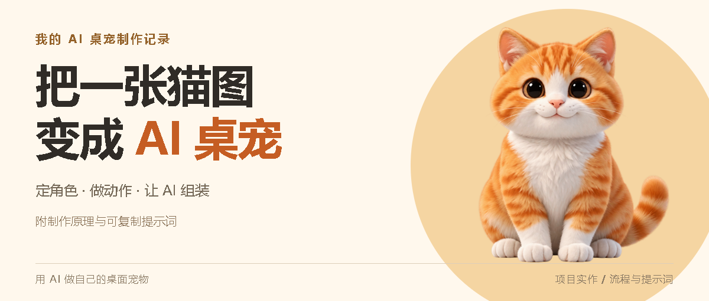
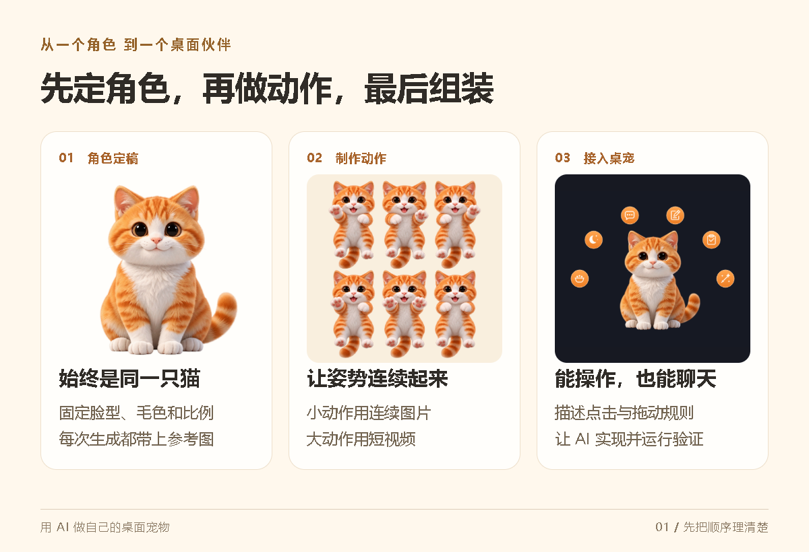
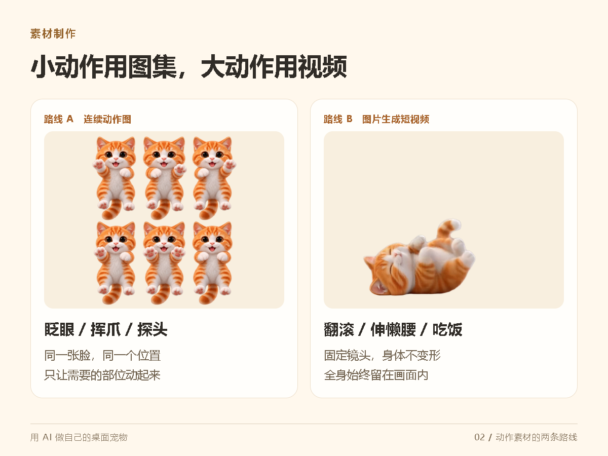
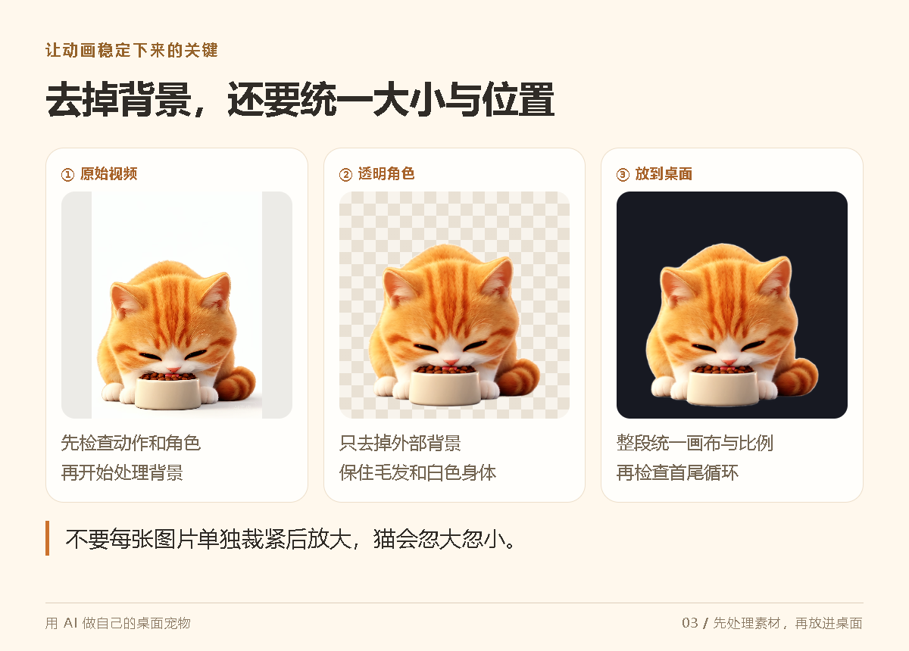
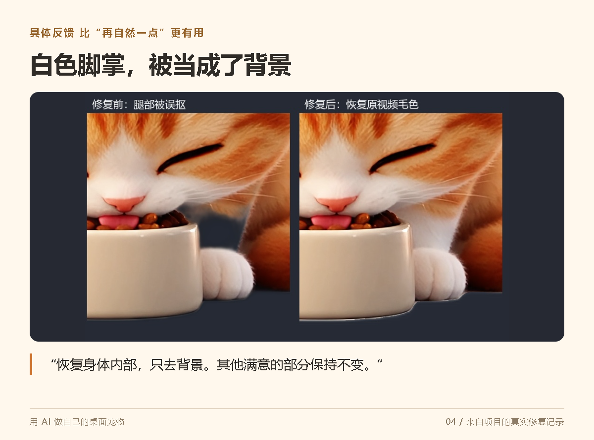
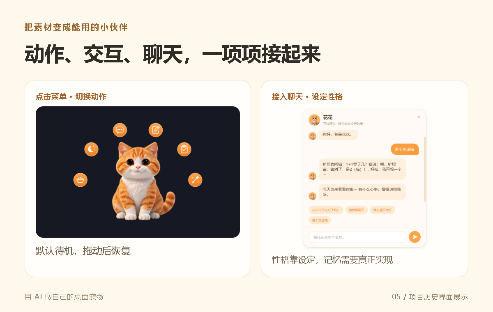

# 这只 AI 桌宠是怎么做出来的

它会在桌面上吃饭、睡觉、翻滚，也能打开聊天窗口，陪你说几句话。

这只叫“花花”的小猫，从形象、动作素材到程序，都是交给 AI 制作的。我负责提需求、看效果，再把不满意的地方说清楚。

做完这个项目，我发现，最需要想清楚的是制作顺序：**先定角色，再做动作，最后让 AI 把它们接起来。**

下面按这个顺序，分享你也可以照着走的流程。每一步都附上可以复制的提示词。

## 第一步 先选定一张角色图

角色定稿就是宠物的“定妆照”。后面不管生成吃饭还是睡觉，都要把这张图作为参考带上。

否则，很容易出现一种情况：待机时还是圆脸橘猫，吃饭时就变了毛色，睡醒连眼睛都不一样了。

先把脸型、毛色、身体比例和画风确定下来。选定后，再逐项修改，不要每个动作都重新设计一遍。

**把这段发给图像生成工具：**

> 帮我设计一只橘白猫桌面宠物。毛茸茸的立体卡通风格，圆脸、短腿、深棕色大眼睛，白色胸口和脚掌。正面坐姿，全身完整入画，耳朵、尾巴不能被裁切。固定镜头，干净背景，不要文字和装饰。

选好后，每次生成动作都附上它，再补一句：

> 这张图是唯一的角色外观参考。保持脸型、毛色花纹、眼睛和身体比例一致，只修改本次要求的动作。

## 第二步 小动作用图集 大动作用视频

眨眼、挥爪这种小动作，可以做成几张连续图片。一张图分成几个格子，每格都是同一只猫在不同时刻的姿势。

本项目的拖拽素材，就是一张六格动作图。头和身体尽量不动，只让前爪交替活动。

**动作图提示词：**

> 基于参考猫，制作两行三列的连续挥爪动作图。六格中的头、鼻尖、身体位置和大小一致，只让两只前爪小幅交替伸出和收回。不要多出肢体，不要挡住脸，不要文字、格线和背景。

翻滚、伸懒腰、吃饭这种连续动作，可以先做成短视频，再处理成桌宠素材。

**图生视频提示词：**

> 用参考图中的同一只猫，生成一段短玩耍视频。小幅翻滚后伸懒腰，动作连贯。镜头固定，不推拉，不改变角色大小。全身始终在画面内，背景保持单一纯色，开头和结尾尽量停在接近的姿态。

这里有三个约束特别有用：**镜头固定、全身入画、角色不变。**

先检查动作有没有变形，再做下一步。视频里多出来的一条腿，去掉背景以后也不会自动消失。

## 第三步 去背景之外 还要让动作稳定

图片和视频生成后，还需要去掉背景、统一大小和位置，再接成循环。

这一步最容易被忽略的是“统一”。

如果每一张图片都单独裁到最紧，再放大到相同尺寸，播放起来，猫就会忽大忽小、上下跳动。正确的要求是：**整段动作使用同一套画布和缩放方式。**

**把素材交给 AI 编程助手：**

> 请把这份素材处理成透明桌宠动画。保留原始素材，去除背景，保留毛发和白色身体。整段动作统一画布、裁切范围和缩放比例，不要逐张裁紧后放大。检查循环衔接，先给我浅色、深色背景下的预览，再接入桌宠。

循环也要单独检查。最后一帧突然跳回第一帧，会让动作像卡了一下。

本项目的玩耍动画采用了正放再倒放，让猫沿着原来的动作回到起点。但吃饭、吞咽、走路等动作不一定适合倒放，还是要看实际预览。

## 第四步 反馈要具体到画面

项目里就遇到过：去背景时，猫的白色脚掌也被误处理成了透明。

这种时候，说“再自然一点”很难让 AI 找到问题。换成下面这样，目标就清楚了：

> 白色脚掌被误抠掉了。请恢复身体内部，只去掉外部背景，保留原视频的毛色，并在深色背景上检查。其他已经满意的部分保持不变。

同样的反馈方式也适用于其他问题：

- 头在抖：固定鼻尖和头部位置，只保留爪子的动作。
- 切换动作后变大：按猫身体的视觉大小统一比例。
- 首尾跳变：重新选择循环起止位置，避免用重影掩盖。
- 新动作变了脸：重新附上定稿，只保留新版本的动作设计。

**描述哪里不对，也说明哪些地方已经满意。**这样更容易保住前面做好的效果。

## 第五步 让 AI 把素材接成桌宠

素材准备好后，把操作方式说清楚：

> 请把这些动作接入桌宠。默认待机，点击后可以选择吃饭、睡觉、玩耍；按住可以拖动，松开恢复之前的状态。各动作大小协调，提供恢复待机和退出。一次接入一个动作，运行给我看，再继续下一项。

然后再加聊天：

> 给桌宠加入聊天功能，让用户在设置里配置自己的模型服务。等待回复时，动画和拖动仍然正常。它叫花花，说话温暖、简洁，偶尔调皮，但认真提问时先认真回答。

想让它重启后还记得事情，就要继续让 AI 做真正的记忆功能。只写一句“你会永远记住主人”，并不会自动保存信息。

## 第一只宠物 可以从很小的目标开始

先做一张你喜欢的角色图，再让它会眨眼、能拖动、可以退出。

等它真的出现在桌面上，再逐渐增加吃饭、睡觉、聊天。每一步都有可以观看、比较和修改的结果，这个过程就会清楚很多。

**你想让什么角色住进自己的桌面？会给它起什么名字？**
